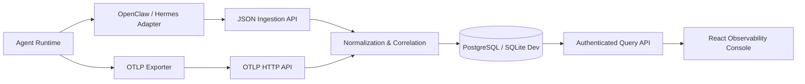

# Firefly · Agent Observability

> 面向 Agent 运行链路的轻量级可观测平台：统一采集 Trace、LLM 调用、工具调用、Token、成本、时延与错误，并在一个工作台中完成检索和诊断。

[](LICENSE)


Firefly（萤火）是一个可独立部署的 Agent 可观测性 MVP。它把不同 Agent 框架的运行数据归一为 Trace / Span 模型，帮助开发者回答：一次任务经历了哪些步骤、调用了哪些工具、消耗多少 Token、哪里变慢、为什么失败。

## 核心能力

- **统一采集**：支持 JSON Ingestion API 与 OTLP/HTTP Protobuf Trace 摄入。
- **Agent 链路还原**：展示 Trace 列表、Span 树、会话转录、工具调用和关联运行链路。
- **运行指标**：汇总 Trace/Span 数量、错误率、Token、成本、平均与 P95 时延。
- **项目级隔离**：包含用户注册登录、组织、成员关系、项目与项目级数据访问控制。
- **关联与归一化**：优先使用原生关联 ID，必要时通过受控时间窗口聚合同一轮任务。
- **框架适配**：OpenClaw TypeScript Adapter 与运行时插件；Hermes Python Adapter 实验实现。

## 架构



## 技术栈

| 层级 | 技术 |
| --- | --- |
| Backend | FastAPI, Pydantic v2, SQLAlchemy Async, Alembic |
| Frontend | React 19, TypeScript, Vite, Tailwind CSS, TanStack Query |
| Storage | PostgreSQL 17；SQLite 仅用于本地开发 |
| Telemetry | OpenTelemetry OTLP/HTTP Protobuf、自定义 JSON Ingestion API |
| Deployment | Docker Compose, Nginx |

## 快速开始

### Docker Compose（推荐）

```bash
cp deploy/.env.example deploy/.env
# 编辑 deploy/.env，至少替换 POSTGRES_PASSWORD 和 INGEST_API_KEY
docker compose --env-file deploy/.env -f deploy/docker-compose.yml up -d --build
```

启动后访问：

- 工作台：<http://localhost:3000>
- API 文档：<http://localhost:8000/docs>
- 健康检查：<http://localhost:8000/health>

首次使用时在工作台注册账号，创建组织和项目，然后把项目 UUID 与 `INGEST_API_KEY` 配置到 Agent Adapter。

### 本地开发

后端：

```bash
cd backend
python -m venv .venv
source .venv/bin/activate
pip install -r requirements.txt
cp .env.example .env
uvicorn app.main:app --reload
```

Windows PowerShell 可使用 `.venv\Scripts\Activate.ps1` 激活环境。

前端：

```bash
cd frontend
npm ci
npm run dev
```

### 上报一条 Trace

```bash
curl -X POST http://localhost:8000/api/v1/ingest/trace \
  -H "Content-Type: application/json" \
  -H "X-Firefly-Key: replace-with-your-ingest-key" \
  -d '{
    "project_id": "00000000-0000-0000-0000-000000000000",
    "name": "demo-agent-turn",
    "timestamp_start": "2026-01-01T00:00:00Z",
    "status": "ok",
    "input": {"prompt": "Summarize this document"},
    "output": {"text": "Summary completed"},
    "spans": []
  }'
```

OTLP/HTTP 使用 `/v1/traces`，并同时发送：

- `X-Firefly-Key: <ingest-key>`
- `X-Firefly-Project-ID: <project-uuid>`

## Adapter

| Adapter | 状态 | 入口 |
| --- | --- | --- |
| OpenClaw TypeScript Adapter | 可构建、可集成 | [`adapters/openclaw`](adapters/openclaw) |
| OpenClaw Runtime Plugin | 可配置插件 | [`adapters/openclaw-plugin`](adapters/openclaw-plugin) |
| Hermes Python Adapter | 实验性，未完成生产端到端验收 | [`adapters/hermes`](adapters/hermes) |

## 当前边界

Firefly 目前是可运行的开源 MVP，不等同于成熟商业 APM 平台：

- 已实现核心采集、查询、工作区和可视化链路。
- Prompt 与 Session API 已具备基础模型，管理界面仍在完善。
- 当前采集端使用部署级共享密钥；企业级密钥轮换、限流、审计与细粒度 RBAC 仍需增强。
- Adapter 上报内容可能包含 Prompt、模型输出和工具参数，接入前应按组织安全规范做脱敏与保留策略配置。

## 仓库结构

```text
.
├─ backend/                 FastAPI 服务、数据模型与迁移
├─ frontend/                React 可观测工作台
├─ adapters/
│  ├─ openclaw/             TypeScript Adapter
│  ├─ openclaw-plugin/      OpenClaw 运行时插件
│  └─ hermes/               Python Adapter（实验性）
├─ deploy/                  Docker Compose 部署模板
└─ docs/                    设计记录与开发说明
```

## 安全与贡献

- 安全问题请参阅 [SECURITY.md](SECURITY.md)，不要把密钥、数据库或真实 Trace 提交到仓库。
- 参与开发请先阅读 [CONTRIBUTING.md](CONTRIBUTING.md)。

## License

Apache License 2.0，详见 [LICENSE](LICENSE)。
